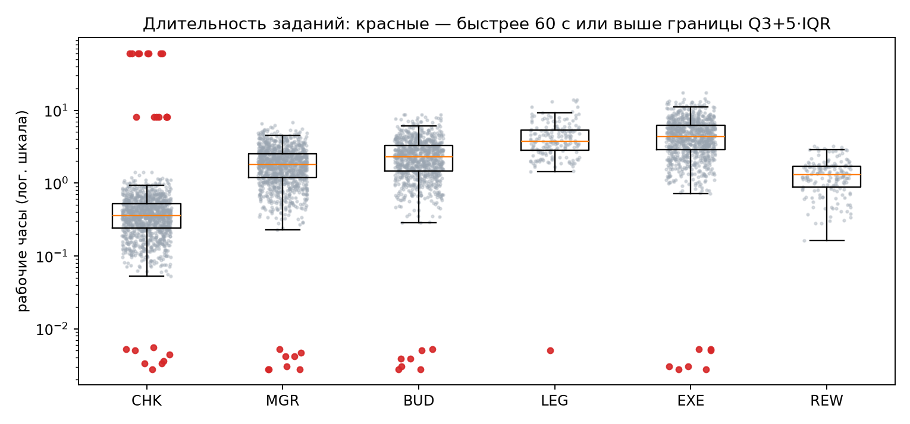
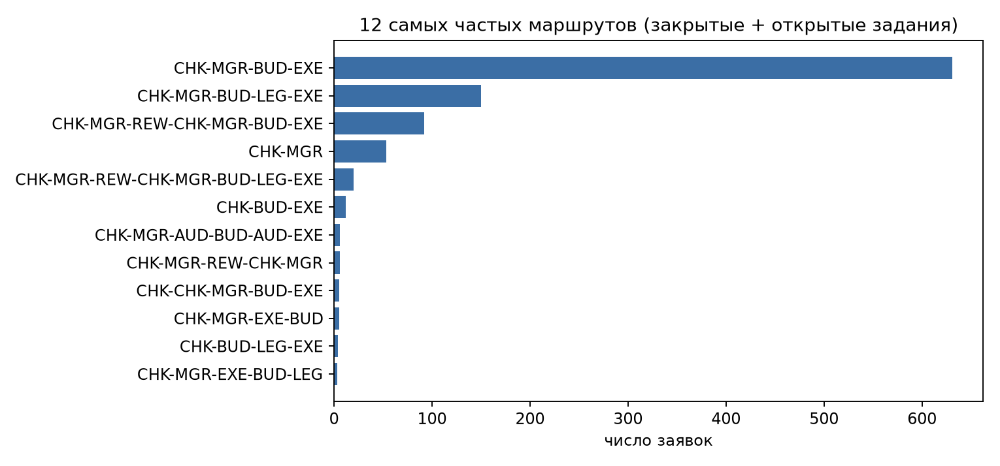
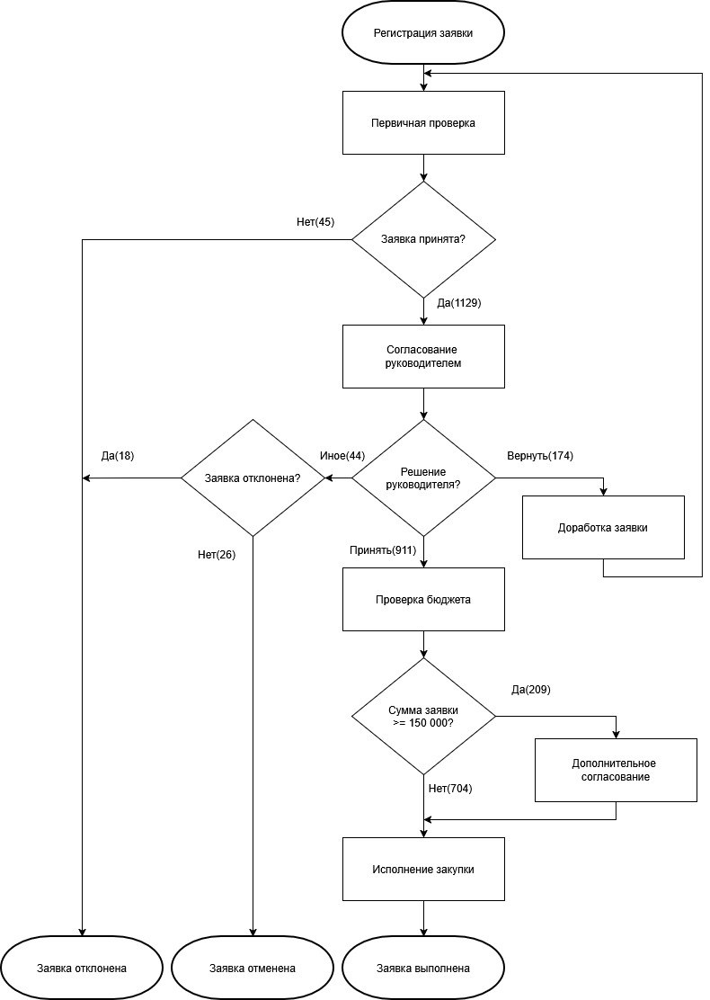

# Анализ данных: продуктовая аналитика и process mining

Репозиторий объединяет три аналитических проекта:

| № | Проект | Папка | Данные | Результат |
|---|---|---|---|---|
| 1 | [Поиск нетипичного поведения заявок на закупку](#проект-1-поиск-нетипичного-поведения-заявок-на-закупку) | `practice_task_one/` | `students.csv` (1000 заявок) | 88 строк аномалий по 80 заявкам (8 %) |
| 2 | [Восстановление процесса закупки](#проект-2-восстановление-процесса-закупки-по-журналу-событий) | `practice_task_two/` | `students.csv` (1000 заявок, 6508 событий) | модель процесса, блок-схема, 8 вариантов маршрута |
| 3 | [Продуктовые гипотезы по данным VPN-сервиса](#проект-3-продуктовые-гипотезы-по-данным-vpn-сервиса) | `practice_task_three/` | дамп БД, логи подключений, клиентские логи | 5 гипотез с вердиктами и цифрами |

> Файлы `students.csv` в проектах 2 и 3 относятся к разным журналам (у них разные наборы этапов и ролей), поэтому лежат в своих папках отдельно.

## Структура репозитория

```
practice/
├── README.md
├── practice_task_one/     
├── practice_task_two/     
└── practice_task_three/   
```

Внутри каждой папки лежат код, результаты и (при необходимости) собственные файлы данных; подробности по файлам — в описании соответствующего проекта ниже.

---

---

# Проект 1. Поиск нетипичного поведения заявок на закупку

Анализ журнала событий выполнения заявок на закупку (`students.csv`): 1000 заявок, срез 01.07.2026 00:00 UTC+3. Результат: 88 строк аномалий по 80 заявкам (8 %).

## Файлы

| Файл | Назначение |
|---|---|
| `practice_task_one/analyze.py` | весь анализ, формирует остальные файлы |
| `practice_task_one/anomalies.csv` | список аномалий: `ProcessInstanceId,AnomalyType,Explanation` |
| `practice_task_one/summary.json` | сводные числа (качество данных, базовые линии, число аномалий по типам) |
| `practice_task_one/fig_durations.png`, `fig_routes.png` | графики |

## Запуск

```bash
cd practice_task_one
pip install pandas numpy matplotlib
python analyze.py --input students.csv --outdir .
```

Без аргументов скрипт ищет `students.csv` в текущей папке и пишет результаты туда же. Ожидаемый вывод: `строк: 88, процессов: 80 из 1000`.

## 1. Инструменты и шаги

Python 3, pandas, numpy, matplotlib. ML не использовался.

1. Загрузка CSV (UTF-8 с BOM), время переводится в UTC+3, сортировка по `ProcessInstanceId, EventIndex`.
2. Проверка качества: дубли `EventId`, пропуски в `EventIndex`, монотонность времени, пары создание/закрытие по `TaskId`, отрицательные длительности.
3. Длительность задания = закрытие − создание (один `TaskId`) в календарных и в рабочих часах (пн–пт 09:00–18:00).
4. Маршрут заявки = последовательность этапов: `CHK` проверка, `MGR` руководитель, `BUD` бюджет, `LEG` юрист, `EXE` исполнение, `REW` доработка, `AUD` внеплановая проверка.
5. Набор правил-детекторов, каждое срабатывание — строка в `anomalies.csv` с числовым объяснением.

## 2. Обычное поведение

- Журнал чистый: нет дублей `EventId`, индексы без пропусков, время монотонно, у всех закрытий есть создание.
- Основные маршруты: standard и urgent — `CHK→MGR→BUD→EXE`; contract — `CHK→MGR→BUD→LEG→EXE`. Обычный возврат — один цикл `MGR→REW→CHK→MGR` (119 из 127 заявок с возвратами). Отказ руководителя — 51 заявка.
- Роли строго по этапам: проверка — specialist, согласование — manager, бюджет — finance, юрист — legal, исполнение — procurement, доработка — requester.
- Медианы (рабочие часы): проверка 0,40; руководитель 2,0; бюджет 2,6; юрист 3,7; исполнение 4,9; доработка 1,4. Срочные заявки быстрее, поэтому норма считается отдельно для каждой пары «этап × тип заявки».

## 3. Критерии

Пороги берутся из данных. Рабочие часы используются, потому что календарная длительность искажается выходными.

| Тип отклонения | Критерий |
|---|---|
| Пропущен этап «руководитель» | заявка дошла до `EXE` без закрытого `MGR` |
| Исполнение до согласования | `BUD`/`LEG`/`MGR` закрыты позже `EXE` |
| Повторная проверка без возврата | `CHK` сразу после `CHK`, без `REW` между ними |
| Внеплановая проверка (auditor) | есть этап `AUD` |
| Циклические возвраты | число `REW` > Q3+3·IQR (среди заявок с возвратами; нормально 1, у отмеченных 5–8) |
| Согласование не руководителем | роль закрытия ≠ ожидаемой роли этапа |
| Аномально долгий этап | рабочие часы > Q3+5·IQR для этапа и типа |
| Зависшее задание | открытое задание старше той же границы на срез |
| Мгновенное прохождение | ≥ 2 задания заявки закрыты быстрее 60 с |

## 4. Результаты

| Тип отклонения | Заявок |
|---|---|
| Пропущено согласование руководителем | 16 |
| Аномально долгая проверка (8 × ≈60 раб. ч, 8 × ровно 8 раб. ч) | 16 |
| Исполнение до согласования бюджета/юриста | 8 |
| Повторная проверка без возврата | 8 |
| Внеплановая проверка auditor | 8 |
| Циклические возвраты (5–8) | 8 |
| Согласование ролью requester (2 самосогласования) | 8 |
| Мгновенное прохождение (6–20 с на задание) | 8 |
| Зависшее согласование открытой заявки (≈140–160 суток) | 8 |

8 заявок попали в две строки (долгая проверка + пропущенный руководитель).




Примеры: `17b4a994-a650-5539-979c-114b14dc20d6` (проверка 60 раб. ч при медиане 0,14 и нет руководителя), `26b4c1f5-fe6b-540d-a343-ae6aac25f87f` (4 задания за 7–19 с), `363974d3-8b55-58e7-a74e-7f3b5ec0a6b7` (согласование открыто 156 суток).

## 5. Ограничения и ручная проверка

- Открытых заявок 10. Две (исполнение создано 30.06) нормальны и не помечены; 8 с зависшим согласованием помечены из-за ожидания в десятки раз выше границы.
- Внеплановая проверка auditor может быть законным контролем: критерий — только наличие этапа, оправданность по данным не определить.
- Длительности включают ожидание, а не чистую работу. Проверка ровно в 8 раб. ч может быть допустимой задержкой, хотя в ≈20 раз выше медианы.
- Возвраты 5–8 раз могут быть оправданы сложной заявкой.
- 25 событий в 10 процессах датированы 01.07.2026 (09:16–17:59), то есть позже заявленного среза. В `anomalies.csv` не включены.
- 742 заявки стартуют ровно в 09:00:00 — вероятно, пакетная регистрация.
- Метод не учитывает праздники, обед и содержание заявки; сумма в правилах не используется.

---

# Проект 2. Восстановление процесса закупки по журналу событий

Практика 2: Process Discovery. По журналу `students.csv` (1000 экземпляров, 6508 событий, одна версия шаблона) восстановлена модель нормального поведения процесса обработки заявок на закупку.

## Схема



## Метод

1. События сгруппированы по `ProcessInstanceId` и отсортированы по числовому `EventIndex`.
2. Повторы активностей не удалялись (у них разные `TaskId`).
3. Подсчитаны полные маршруты (варианты), пары непосредственно следующих действий, значения `Result` по активностям.
4. Проверена связь `Amount` с наличием «Дополнительного согласования».
5. Инструменты: Python 3, pandas, Graphviz (схема). ИИ для получения выводов не применялся, все числа воспроизводятся скриптом.

Проверки согласованности: сумма вариантов = 1000; исходы 911 + 63 + 26 = 1000; «Доработок» 138 + 2·18 = 174.

## Результаты

**Активности (10).** Старт — «Регистрация заявки» (автоматически). Человеческие задания и роли:

| Активность | Роль |
|---|---|
| Первичная проверка | specialist |
| Согласование руководителем | manager |
| Доработка заявки | requester |
| Проверка бюджета | finance |
| Дополнительное согласование | director |
| Исполнение закупки | procurement |

**Окончания (3).** «Заявка выполнена» — 911 (91,1 %), «Заявка отклонена» — 63 (6,3 %), «Заявка отменена» — 26 (2,6 %).

**Основной маршрут** (V1, 56,7 %): Регистрация заявки → Первичная проверка → Согласование руководителем → Проверка бюджета → Исполнение закупки → Заявка выполнена.

**Обязательные и необязательные этапы:**
- «Регистрация» и «Первичная проверка» есть в 100 % случаев.
- «Согласование руководителем» есть в 95,5 % (955 из 1000), нет только у 45 заявок, отклонённых на первичной проверке.
- «Проверка бюджета» и «Исполнение закупки» есть в 91,1 % случаев; для заявок, не отклонённых и не отменённых, — в 100 %.
- «Доработка заявки» есть в 15,6 % случаев (156).
- «Дополнительное согласование» есть в 22,9 % выполненных заявок (209 из 911).

**Развилки** (Result: число событий):
- После «Первичной проверки»: accept 1129, reject 45 (reject только на первом проходе).
- После «Согласования руководителем»: accept 911, return 174, reject 18, cancel 26.
- После «Проверки бюджета»: всегда accept (911); далее «Дополнительное согласование» (209) либо сразу «Исполнение» (702). Выбор определяется суммой: у всех 209 заявок с доп. согласованием `Amount` ≥ 150 614,59, у всех 702 без него ≤ 149 743,41. Правило «сумма ≥ 150 000» разделяет выполненные заявки без ошибок.

**Возвраты.** Единственный цикл: Согласование → Доработка → Первичная проверка → Согласование. Один возврат — 138 случаев (117 + 21), два — 18, три и более не наблюдались. Возврат возможен только после согласования руководителем (174 из 1129 решений, 15,4 %).

## Варианты

Полные названия маршрутов — в `practice_task_two/variants.csv`. Сокращения: Рег — Регистрация заявки, ПП — Первичная проверка, СР — Согласование руководителем, Дор — Доработка заявки, ПБ — Проверка бюджета, ДС — Дополнительное согласование, Исп — Исполнение закупки.

| № | Маршрут | Случаев | Доля | Пример ID |
|---|---|---:|---:|---|
| V1 | Рег > ПП > СР > ПБ > Исп > Выполнена | 567 | 0.567 | `00f3e3a0-9d7d-5eac-98a9-b605b6893e61` |
| V2 | Рег > ПП > СР > ПБ > ДС > Исп > Выполнена | 188 | 0.188 | `01ae1813-1d99-5524-8f81-77ad5452c33e` |
| V3 | Рег > ПП > СР > Дор > ПП > СР > ПБ > Исп > Выполнена | 117 | 0.117 | `015bf5dd-d3b4-5b89-8814-7ca369f74e92` |
| V4 | Рег > ПП > Отклонена | 45 | 0.045 | `08a60c66-22dd-5cf8-90dd-71ba3d53f349` |
| V5 | Рег > ПП > СР > Отменена | 26 | 0.026 | `00e3854b-efb6-59c7-ac6a-c85643843db1` |
| V6 | Рег > ПП > СР > Дор > ПП > СР > ПБ > ДС > Исп > Выполнена | 21 | 0.021 | `055f6c87-61a2-52aa-86ec-940480c96dcd` |
| V7 | Рег > ПП > СР > Дор > ПП > СР > Дор > ПП > СР > ПБ > Исп > Выполнена | 18 | 0.018 | `009608ae-1567-584a-b67a-c7ec60ec587d` |
| V8 | Рег > ПП > СР > Отклонена | 18 | 0.018 | `02bf4e3d-60b1-5713-9886-43fa49c67001` |

Варианты покрывают весь журнал (сумма долей = 1). Редкие маршруты V4–V8 считаются нормальным поведением, а не ошибками.

## Факты и гипотезы

| Наблюдаемый факт | Гипотеза (в данных не доказана) |
|---|---|
| 12 различных пар переходов, 8 маршрутов, 3 исхода | Порог доп. согласования ровно 150 000 (в данных между 149 743,41 и 150 614,59) |
| Возврат только после согласования руководителем, всегда через первичную проверку | Лимит возвратов равен 2 (в данных максимум 2) |
| Reject и cancel встречаются только на первом проходе | На повторном проходе возможны, но не наблюдались |
| «Проверка бюджета» всегда accept | Ветка отказа финансов может существовать, но не используется |

## Ограничения

Журнал показывает порядок событий, а не внутренние правила системы: одинаковые трассы могут порождаться разными схемами. Граф непосредственно следующих действий (12 пар из `practice_task_two/student_transitions.csv`) допускает больше поведения, чем наблюдалось:
- неограниченное число возвратов (в данных максимум 2);
- «Проверка бюджета → Исполнение» и «Проверка бюджета → Дополнительное согласование» равноправны, хотя выбор определяется суммой;
- отклонение на повторной первичной проверке и отмена после возвратов допускаются графом, но не наблюдались.

Интервалы между событиями включают очередь и нерабочее время, поэтому как время труда не интерпретировались.

---

# Проект 3. Продуктовые гипотезы по данным VPN-сервиса

Анализ выгрузки серверной БД и клиентских логов подписочного VPN-сервиса (мобильные и десктоп-клиенты, тарифы Basic / Silver / Gold / Diamond / Lite, платный триал 1 USD на 3 дня). Цель: сформулировать продуктовые гипотезы и подтвердить их данными.

> Сами данные (CSV-дамп БД, архивы логов) в репозиторий не входят: в репозитории только код и агрегированные результаты.

## Данные

| Источник | Объём | Что внутри |
|---|---|---|
| Дамп БД | 35 CSV без заголовков (имена колонок в `db_structure/`) | пользователи (1,84 млн), заказы, транзакции, подписки, устройства, сессии, просмотры рекламы (7,55 млн), версии приложения |
| `user_connection_logs_*` | ≈ 23 млн строк, 02–09.2026 | факты подключений к нодам (без объёма трафика) |
| Клиентские логи инцидентов | ≈ 5 ГБ, 926 архивов, 781 пользователь | клиентский `.log`, `vpn_access_log.txt`, `vpn_error_log.txt`, logcat на Android |

## Гипотезы и результаты

| № | Гипотеза | Вердикт | Ключевая цифра |
|---|---|---|---|
| 1 | Часть пользователей заводит новые аккаунты ради триала | Подтверждена (нижняя оценка) | ≥ 6,6 % триалов (1 461 из 22 193) сделаны на общих картах; конверсия падает с 58,8 % до 39,0 % с ростом числа аккаунтов на карте |
| 2 | Лимиты free-тарифа (500 МиБ в день) заданы «на глаз» | Частично: оптимум по данным не определить | медиана потребления 177 МиБ; упор в лимит в 22 % дней (по пользователям) и 33 % (по дням); 1 просмотр рекламы = +≈191 МиБ |
| 3 | Покупке предшествует триал, переход с free занимает дни | Частично | 60 % платят в первый час; триал был у 65 % покупателей; 35 % покупают без триала |
| 4 | Типовые ошибки сгруппированы вокруг нескольких причин | Подтверждены паттерны | `auth/verify` без ответа у 626 пользователей; 8,3 млн DNS-ошибок VPN-ядра, на отдельных нодах в 10–15 раз больше |
| 5 | Значимая часть пользователей не доходит до оплаты триала | Подтверждена | 9 234 пользователя пытались оплатить и не оплатили; статус `failed` — это в основном просроченная ссылка (медиана 62 мин против ≈ 2 мин у успешных платежей) |

Подробные таблицы, распределения и пороги: см. `practice_task_three/results/`.

## Что получилось, а что нет

- **Признаки мультиаккаунтов.** Не работают: `device_identifier` на Android (там пишется Build ID прошивки, 1 561 уникальное значение на 885 тыс. строк), `appmetrica_device_id` (пустой), IP (CGNAT), внешние аккаунты (связь 1:1). Работает сохранённая карта (first6 + last4).
- **Лимиты.** Объёма трафика нет ни в БД, ни в логе Xray. Он найден только в клиентских логах (строка `Traffic info changed`), то есть для 80 пользователей и 426 пользователь-дней. Месячный лимит 15 ГБ по данным проверить нельзя. Строгий оптимум не определяется, нужен A/B-тест 500 / 750 / 1000 МиБ.
- **Выборка логов самоотобранная** (их присылают пользователи с проблемами), поэтому для частоты ошибок во всей базе она не годится, только для паттернов.
- Таблица `sub_limit` отсутствует в выгрузке, лимиты тарифов из БД не видны.
- Время в `users` и `orders` расходится примерно на 3 часа, при расчёте интервалов добавлена поправка.
- Соответствие `provider_id` и провайдера (2 — Yookassa, 1 — TipTopPay, 3 — Heleket) определено по объёму заказов.

## Дополнительные находки

- Клиент пишет в лог HTTP-запросов полный `Authorization: Bearer <JWT>`.
- В `adv_view_history` 321 пользователь-день с более чем 100 просмотрами рекламы (максимум 1 886 в день): похоже на накрутку.
- Gold и Diamond почти не продаются (487 и 95 оплат против 41 725 у Lite).

## Скрипты

```
practice_task_three/scripts/
  build.py          загрузка CSV в DuckDB (имена колонок из db_structure)
  profile.py        общий профиль данных
  h.py              гипотезы 1, 3 и лимиты через рекламу (БД)
  parse_logs.py     разбор архивов клиентских и VPN-логов в out/*.csv
  h2.py             гипотезы 1, 3, 5 и ошибки, углублённый анализ
  parse_traffic.py  объём трафика и причины отключений из клиентских логов
  final.py          поправки: сброс счётчика, взвешивание по пользователям, длительность платежей
```

## Запуск

Нужны Python 3 и `pip install -r practice_task_three/requirements.txt`. Скрипты используют относительные пути, поэтому запускать их нужно **из папки с данными** (там, где лежат CSV, `db_structure/` и `logs/`). Порядок важен: `h2.py` читает `out/*.csv` после `parse_logs.py`, а `final.py` читает `out/traffic.csv` после `parse_traffic.py`.

```bash
cd /путь/к/данным
python3 /путь/к/репозиторию/practice_task_three/scripts/build.py
python3 /путь/к/репозиторию/practice_task_three/scripts/profile.py
python3 /путь/к/репозиторию/practice_task_three/scripts/h.py
python3 /путь/к/репозиторию/practice_task_three/scripts/parse_logs.py
python3 /путь/к/репозиторию/practice_task_three/scripts/h2.py
python3 /путь/к/репозиторию/practice_task_three/scripts/parse_traffic.py
python3 /путь/к/репозиторию/practice_task_three/scripts/final.py
```

База `synaptic.duckdb` и промежуточные файлы `out/` создаются в папке с данными.
